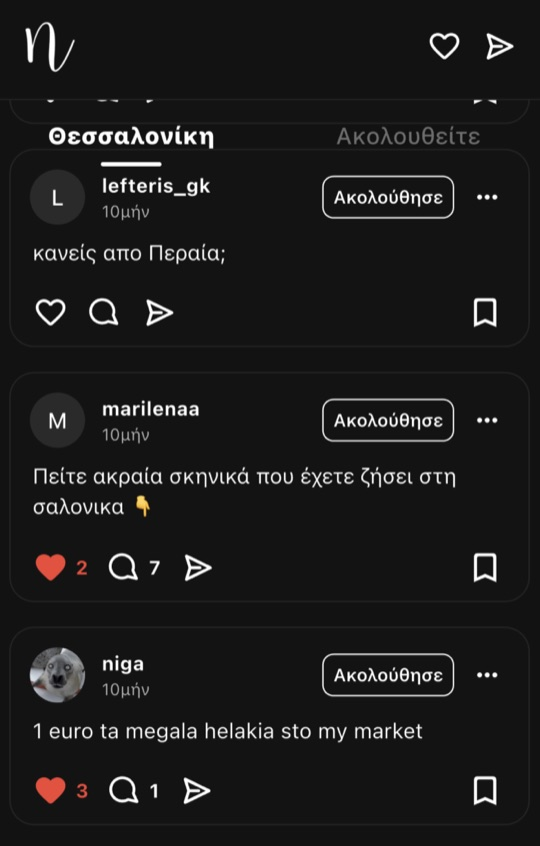
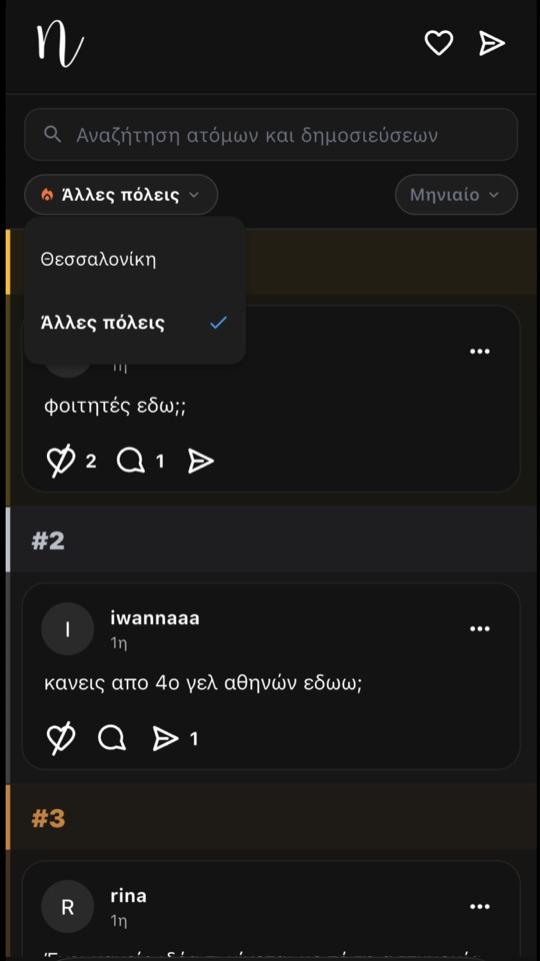
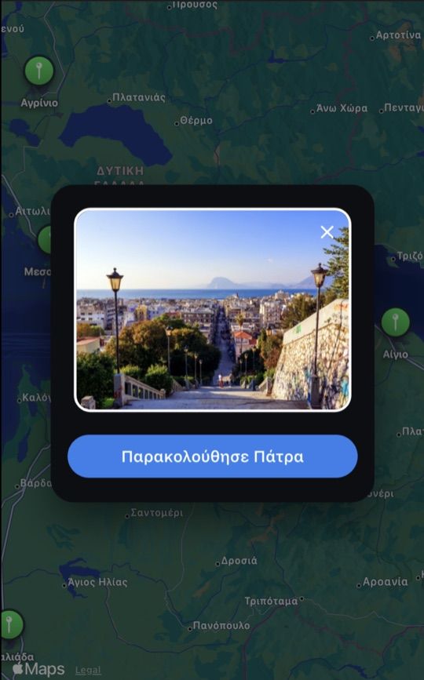
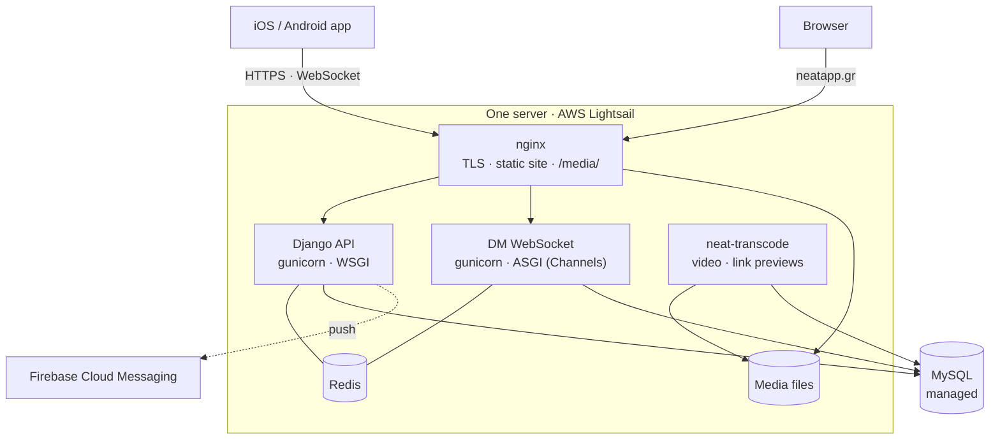

<h1 align="center">Neat — backend</h1>

<p align="center">
  <strong>A social network with one feed per city.</strong><br>
  You post in the city you live in. Every other city in Greece you can watch.
</p>

<p align="center">
  <a href="https://apps.apple.com/gr/app/id6748038152">App Store</a> ·
  <a href="https://play.google.com/store/apps/details?id=gr.app.neat">Google Play</a> ·
  <a href="https://neatapp.gr">neatapp.gr</a> ·
  <a href="https://github.com/rrizos/neatfrontend">App repo</a>
</p>

<p align="center">
  
  
  
</p>

---

## What Neat is

Neat splits Greece into cities, and every city has its own feed. You post,
like and comment in the city you live in; every other city you can read in
**Spectator Mode** but not change. One national feed, **Ελλάδα**, is open to
everyone. That restriction is the product: it keeps each city's feed made of
the people who are actually there, which is what makes it worth reading.

Around the feeds: **Virals** (each city's top ten posts by day, week and
month), direct messages with photos, voice notes and view-once pictures,
events, and a live map of Greece whose pins warm up when a city is unusually
busy. Cities **unlock** as they reach enough local members, and invite links
and a street-poster ambassador programme bring those members in.

Neat is live on iOS and Android, in Greek and English, across 76 cities.

## This repository

This is the server: the JSON API the app talks to, the WebSocket server for
direct messages, the video pipeline, push notifications, the server-rendered
pages on neatapp.gr, and the internal tools (analytics, health, moderation,
the ambassador programme). The mobile app and the landing page are in
**[rrizos/neatfrontend](https://github.com/rrizos/neatfrontend)**.



Plain Django: function views returning JSON, no Django REST Framework, no
Celery. Every request path is readable top to bottom in one file, and the whole
system runs on a single small instance with a managed database.

| App | What it does |
|---|---|
| [`accounts/`](accounts) | Sign-up and sign-in (email, Apple, Google), profiles, follows, blocks, search, notifications, the admin API |
| [`posts/`](posts) | Feeds, posts, media uploads, the video transcode queue, polls, comments, likes, saves, Virals, city heat, reports |
| [`dm_messages/`](dm_messages) | Direct messages: REST endpoints and the realtime WebSocket consumer; photos, voice notes, view-once photos, reactions |
| [`events/`](events) | Official and community events, attendance, comments |
| [`push/`](push) | Device registration and Firebase push notifications |
| [`linkpreview/`](linkpreview) | Safe Open Graph / oEmbed fetching for link cards |
| [`security/`](security) | A tamper-evident audit log, threat detection, the admin security API |
| [`web/`](web) | Server-rendered pages: shared posts (`/post/<id>`), the safety portal, account deletion, `/analytics`, `/health`, `/runbook` |
| `invites/` † | Personal invite links and referral attribution |
| `ambassadors/` † | The street-poster ambassador programme: short links, QR posters, creator dashboards, payouts |
| `lockedcities/` † | The locked-cities kill switch |
| [`neatbackend/`](neatbackend) | Settings, URLs, ASGI/WSGI, CDN and time-format helpers |

† On the `referrals-ambassadors-killswitch` branch, live in production, not yet
merged into `main`. See [Operations → Branches](docs/operations.md#branches-and-production).

## Documentation

| Doc | Read it for |
|---|---|
| [Architecture](docs/architecture.md) | How a request is served, where data and media live, realtime, the video pipeline, caching, security, and the measured decisions behind them |
| [Apps](docs/apps.md) | Each Django app in turn: its job, models, endpoints, commands and tests |
| [API reference](docs/api.md) | Every endpoint the app calls |
| [Operations](docs/operations.md) | Deploying, the services on the box, scheduled jobs, management commands, health and incident response |

## Running it locally

Python 3.12+ (Django 6).

```sh
python -m venv .venv
.venv/bin/pip install -r requirements.txt
.venv/bin/python manage.py migrate
.venv/bin/python manage.py runserver
```

With no database settings in the environment it uses SQLite, an in-memory
channel layer and a database cache, so nothing else needs to be running. Push,
email and Apple/Google sign-in stay off until their settings are present — see
[Operations → Configuration](docs/operations.md#configuration). Video encoding
and voice-note conversion need `ffmpeg` on the `PATH`.

> **Note:** `main` does not start as committed — see
> [Operations → Branches](docs/operations.md#branches-and-production). Until
> that is fixed, run from `referrals-ambassadors-killswitch`.

## Tests

```sh
.venv/bin/python manage.py test        # 281 tests on referrals-ambassadors-killswitch, ~45 s, SQLite
```

The suite leans on the parts that fail expensively: the feed's payload shape and
query count, the transcode queue, view-once photos, voice-note containers,
Apple/Google token verification, the link-preview fetcher, event ingestion,
ambassador attribution and the health page.

## Licence

Proprietary. © 2026 Neat. All rights reserved.
