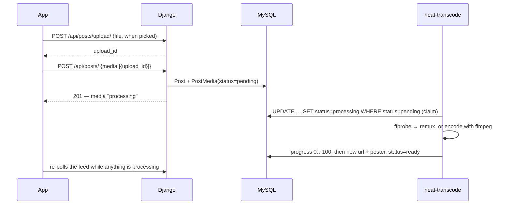

# Architecture

How the Neat server is put together and why. App by app detail is in
[Apps](apps.md), endpoints in the [API reference](api.md), and running it in
[Operations](operations.md).

- [The system](#the-system)
- [A request, end to end](#a-request-end-to-end)
- [API generations: `X-Neat-Client`](#api-generations-x-neat-client)
- [The feed](#the-feed)
- [Media](#media)
- [The video pipeline](#the-video-pipeline)
- [Realtime messaging](#realtime-messaging)
- [Push notifications](#push-notifications)
- [City heat and Virals](#city-heat-and-virals)
- [Link previews](#link-previews)
- [Security](#security)
- [Measured, not guessed](#measured-not-guessed)
- [Limits and what comes next](#limits-and-what-comes-next)

## The system

One AWS Lightsail instance (2 vCPU, 2 GB) runs everything except the database:

| Process | Role |
|---|---|
| **nginx** | TLS for `neatapp.gr` and `api.neatapp.gr` (Let's Encrypt); serves the static site and `/media/` files directly; proxies `/api/`, `/post/`, `/ws/` and the admin pages |
| **gunicorn** (WSGI) | Django: the JSON API and the server-rendered pages |
| **gunicorn-asgi** | Django Channels: the direct-message WebSocket |
| **neat-transcode** | A background worker: encodes uploaded video, then resolves link previews when idle |
| **Redis** | The Channels layer (fan-out between the two gunicorns) and the shared cache |
| **MySQL** | A managed Lightsail database on its own host |

There is no Celery, no message broker and no object store. The background work
is one polling worker that claims jobs with a conditional `UPDATE`, so it is
safe to run more than one. That keeps the moving parts to what one person can
hold in their head, and the box has headroom to spare except on CPU (see
[Limits](#limits-and-what-comes-next)).

## A request, end to end

```
app ─HTTPS─▶ nginx ─unix socket─▶ gunicorn ─▶ middleware ─▶ function view ─▶ JSON
```

1. **nginx** terminates TLS and passes the client IP in `X-Real-IP`.
2. **Middleware**, in order: client IP into a context variable (for attribution)
   → Django security → `ClientVersionMiddleware` (reads `X-Neat-Client`) →
   CORS, sessions, CSRF, auth → `SecurityAuditMiddleware` (last, so it sees the
   final status code).
3. **The view** is a plain function. It authenticates with
   `Authorization: Token <key>` (`accounts/auth.py`), reads JSON or multipart,
   and returns `JsonResponse`. API views are CSRF-exempt because they use
   token auth, not cookies.
4. **Database:** MySQL with persistent connections (`CONN_MAX_AGE = 60` with
   health checks) — before that, every request paid a TCP and TLS handshake to
   the managed database.

**Auth tokens** are random 64-character keys in `AuthToken`, issued at sign-up
and sign-in (email, Apple or Google) and deleted at logout or password reset.
Apple and Google identity tokens are verified on the server against each
provider's published signing keys — signature, audience, issuer, expiry, and
Apple's nonce — never trusted from the client.

## API generations: `X-Neat-Client`

Installed apps update slowly, so the API keeps every shape a released build
depends on and upgrades only builds that ask. Every request carries
`X-Neat-Client: <n>`:

| `n` | Server behaviour |
|---|---|
| missing / 1 | Original shapes: a bare list of posts with full comment threads, base64 media inline |
| ≥ 2 | **Lean feed** (paginated, avatars de-duplicated, comment counts not threads); DM media withheld from threads and fetched per message |
| ≥ 3 | Avatars and media as **URLs** instead of base64 |

`accounts/client_version.py` puts the value in a context variable, so
serializers deep in the stack can choose a shape without a request object. The
current app sends `3`.

## The feed

`GET /api/posts/` is the most-requested endpoint, and it was rebuilt around
measurements:

- **Paginated by a cursor on `(created, id)`**, 20 per page (max 60). Not on
  `id` alone: posts imported from the earlier WordPress community carry old
  dates under new ids, so an id cursor overlapped and skipped pages.
- **Constant query count.** Per-viewer state — liked, saved, which followed
  users liked it, poll votes — is fetched once per page
  (`_viewer_page_context`). Before, a 4-post page took 27 queries and a 20-post
  page 75.
- **Each avatar once.** Authors' avatars go in a single `avatars` map instead of
  repeating on every row.
- **No comment threads**, just counts; the thread loads when it is opened.
- **Link-preview cards from cache only** — one query, never a network fetch in
  the request.
- **Old builds are capped**, not paginated: without the header the response is
  the newest 50 posts with everything inline. Measured on 2026-09-04, a lean
  request was 13 KB and 31 ms; a legacy one 980 KB and 335 ms.

Spectator reads (`?city=<another city>`) return the same feed without
per-viewer state. On `main`, posts also carry a `scope` of `city` or `greece`;
city feeds exclude national posts and `GET /api/posts/greece/` serves them.

## Media

Uploaded files live under `MEDIA_ROOT` on the instance and are served by
**nginx**, not Django, with `Cache-Control: public, max-age=31536000,
immutable` and native Range support (so video seeks).

| Media | Stored as |
|---|---|
| Post photos and videos | `media/posts/<uuid>.jpg|.mp4`, plus a poster frame per video |
| Avatars | `media/avatars/` at 1024 px and 256 px; a small inline copy is kept only for pre-v3 builds |
| DM photos and voice notes | `media/dm/` |
| Event images, comment images, link-preview thumbnails | `media/events/`, `media/posts/`, `media/linkpreview/` |
| **View-once DM photos** | inside the message row, deliberately — see below |

Two rules hold everything together:

1. **A file is never rewritten.** Names are random UUIDs and nginx tells
   clients to cache them for a year, so any change (a re-encode, a new avatar)
   writes a *new* file, repoints the row, and only then deletes the old one.
2. **Deleting a row deletes its files** (`post_delete` signals), with a
   realpath check so a bad URL can never delete outside `MEDIA_ROOT`.

A **view-once** photo is the exception to files-on-disk. The feature promises
the picture stops existing once everyone has used their viewing, which a file
at a stable, cacheable URL cannot promise. So it stays base64 inside the
message row, the thread and inbox never include it, the only route to it is
`POST …/open/` (which spends a viewing), and the last viewing clears the row.

`MEDIA_CDN_URL`, when set, rewrites media URLs to a CDN at serialization time
(`neatbackend/cdn.py`); stored URLs never change. Measured from Greece, the
instance delivers about 3.6 Mbit/s against 42 Mbit/s from a CDN edge.

**Voice notes** are normalised to ADTS AAC under a `.aac` name. iOS picks its
audio parser from the file name, iPhones record ADTS and Android records
MPEG-4, so an Android voice note under `.aac` never played on an iPhone. The
server remuxes (stream copy, ~50 ms) on upload.

## The video pipeline

Encoding used to happen inside the upload request: 18 s of both CPUs for a
minute of 1080p, holding one of the server's request slots the whole time. A
handful of simultaneous uploads occupied every slot and the site stopped
answering. Now the request only stores the file:



- **Fast path.** If the upload is already H.264, yuv420p, ≤ 1920 px on its
  longest edge and ≤ 6 Mbit/s — which is what the app's own compression
  produces — the worker only remuxes it for streaming (`+faststart`): about
  0.1 s instead of ~2 s for a 10 s clip, and far more for long ones.
- **Otherwise** `libx264`, CRF 23, max 1920 px, 5 Mbit/s cap, AAC 128k,
  `nice -n 15`. Progress is parsed from ffmpeg's `-progress` output.
- **Poster frame** at 1 s, not frame 0 — phone videos often open on black.
- **Failures** retry up to three times; after that the original upload is
  served. A video ffmpeg refuses is better than no video, so the API reports a
  failed encode as ready.
- Verified in production: a 60 s upload returned in 0.26 s (was 18.8 s) and
  was ready about 20 s later.

## Realtime messaging

Direct messages are REST for writes and history, plus one WebSocket per app
session for live updates (`dm_messages/consumers.py`, served by the ASGI
gunicorn at `/ws/messages/`).

- **Auth is the first frame** (`{"action":"auth","token":…}`) within 5 s, so the
  token is never in a URL or an access log.
- Each user joins the group `user_<id>`; one socket carries every conversation.
- **Server → app:** `message.new | edited | deleted | reaction`,
  `conversation.new | deleted`, `typing`, `read_receipt`, `presence`,
  `block`, `unblock`. **App → server:** `typing`, `mark_read`, `ping`.
- Presence is a per-user connection counter in the cache, and "offline" is
  only announced after a 3 s grace period so a reconnect does not flicker.
- Views publish through the Redis channel layer, so a message sent through the
  WSGI process reaches sockets held by the ASGI process.

**Threads are paged** (40 per page, `before=<id>`), and media is fetched per
message — opening a synthetic thread of 400 messages and 25 photos went from
7.34 MB to 0.01 MB.

## Push notifications

Firebase Cloud Messaging, sent from `post_save` signals on notifications,
messages and reactions (`push/`).

- Messages are sent with sound and high priority; activity is sent "soft"
  (silent, normal priority).
- Every push carries the badge count (unread DMs + unread notifications).
- Tokens the provider reports as unregistered are deleted on the spot.
- A device registers with a stable device id, and registering removes that
  device's older tokens — one account once had four tokens and received every
  notification four times.

## City heat and Virals

**City heat** (`GET /api/posts/city-heat/`) colours the map. A city's activity
(posts + likes + comments) in the last complete hour is compared with its
hourly average over the previous seven days. Only cities averaging at least 20
actions an hour are eligible, and only ratios of 1.75× or more are returned —
the app draws 1.75× as yellow and 2.5× as orange; everything else is green. The
result is cached per clock hour, so the whole map costs at most a handful of
queries an hour.

**Virals** (`GET /api/posts/viral/`) ranks a city's top ten for the calendar
day, week or month by `likes × 0.45 + comments × 0.55`, in SQL. The same ranking
feeds **Neat Points**, banked per post and day by `award_neat_points`.

## Link previews

Links in posts, comments and messages get Open Graph / oEmbed cards
(`linkpreview/`). Fetching arbitrary URLs from a server is a classic
server-side request forgery hole, so the fetcher:

- allows only `http`/`https` on ports 80/443;
- resolves the host and rejects it if **any** address is private, loopback,
  link-local (the cloud metadata address), reserved or multicast;
- **pins the connection to the address it checked**, setting Host and SNI by
  hand, so DNS cannot change between check and connect;
- follows at most three redirects, re-checking each hop;
- reads at most 512 KB of a page and 4 MB of an image, with 6 s timeouts.

Cards are cached for 7 days (failures for an hour, and a failure never
replaces a working card). Thumbnails are copied to local media, because
Instagram and TikTok image URLs expire in about two days. Cards are resolved
in the background by the worker, so a card appears within seconds of posting
rather than when the first reader scrolls past.

## Security

| Area | What is in place |
|---|---|
| Identity | Token auth; Apple/Google tokens verified against provider keys; account linking by e-mail only when the provider says it is verified |
| Rate limits | Sign-up, login (per IP and per account), social login, password reset (per IP and per identifier), password change, search, link-preview fetches, admin page logins, the deletion form — counters in the shared cache |
| Audit log | `security.AuditLog` — append-only (updates and deletes raise), **hash-chained** so tampering is detectable, with secrets redacted and control characters stripped before writing; written off the request path by a background thread |
| Detection | Brute-force logins, unusually high request volume per account, injection and traversal patterns in URLs, sign-ins from a new IP — recorded for the admin security dashboard |
| Moderation | Reports on posts, comments, messages and events; admin delete, verify, lock/unlock and revoke sessions — from the app's admin panel |
| Privacy | E-mail addresses shown only to their owner and admins; the device's location is never sent; raw error text never returned; view-once photos deleted rather than hidden |
| Blocking | Severs follows both ways; hides the person from profiles, lists, search and DMs; pushes an update to open conversations |

## Measured, not guessed

Most of the design above came from measuring production and fixing the
largest number first:

| What | Before | After |
|---|---|---|
| Video upload request | 18.8 s, holding a request slot | 0.26 s; encoding moved to the worker |
| Already-compliant video | ~2 s re-encode | ~0.1 s remux |
| Post request with a video | ~750 KB | 331 bytes (file staged while the caption is written) |
| Notifications payload | 1191 KB | 19 KB (avatars as URLs) |
| Inbox payload | 125 KB | 5 KB |
| Opening a long DM thread | 7.34 MB | 0.01 MB |
| Feed queries for 20 posts | 75 | constant per page |
| Lean vs legacy feed | 980 KB / 335 ms | 13 KB / 31 ms |
| `/api/events/` | 316 KB per request, 99 % base64 images | images as files |
| A shared-post snapshot in a DM | 520 KB inline (measured) | a file reference |

A graduated load test on 2026-09-03 put the box at a flat ~19 feed requests a
second from 4 to 32 concurrent clients, with 1.2 GB of memory free and 23 of 61
database connections in use: CPU is the only wall. At a load of 17.6 on 2 vCPU
it still answered every request with zero errors.

## Limits and what comes next

- **One instance, CPU-bound.** The next step up is more vCPU (the measured
  wall), then a second app server behind a load balancer — the app already talks
  to `neatapp.gr` rather than an IP, so that is a DNS change.
- **Media on the instance disk.** `MEDIA_CDN_URL` is wired through every
  serializer; moving files to object storage with a CDN in front is the next
  storage step.
- **Old builds.** The legacy feed and the pinned-IP endpoint stay until the
  builds that need them are gone from people's phones.
